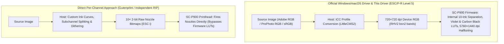

# `ESC/P-R` vs. Gutenprint (`escp2`): Trade-offs and Design Rationale

For earlier Epson photo printers on Linux (such as the Stylus Photo R2880, R3000,
SureColor SC-P600, and **SC-P800**), **[Gutenprint (`libgutenprint`)](https://gimp-print.sourceforge.io/)**
has been the standard open-source driver architecture.

With the **SureColor SC-P900** (and SC-P700), Epson changed how its official
Windows and macOS drivers communicate with the printer. Instead of sending
per-channel nozzle bitmaps from the host, the official drivers send 720 × 720 dpi
RGB raster bands via **`ESC/P-R Level 5`** and leave the 10-channel ink separation
to the printer's firmware.

This page explains the architectural difference, the **limitations and drawbacks**
of the `ESC/P-R` approach, and the pragmatic reasons why `rastertop900escpr` uses
`ESC/P-R Level 5`.

---

## 1. Two Different Ways to Drive an Epson Photo Printer

### Direct Per-Channel Control (Gutenprint / Custom RIPs via `ESC/P2` / `ESC i`)
In a traditional low-level driver or independent RIP:
- The **host software** performs the complete multi-channel ink separation
  (`PK, MK, LK, LLK, C, LC, VM, VLM, Y, Violet`), variable droplet dithering
  (small / medium / large drops), ink-limit enforcement, and pass scheduling.
- The host sends raw 2-bit-per-nozzle droplet bitmaps (`ESC i` raster bands) to
  the printhead.
- **Main benefit:** Complete freedom over every individual ink channel, droplet
  size, and total ink limit.

### Firmware-Managed Separation (`ESC/P-R Level 5`, used by this driver)
On the SC-P900 and SC-P700, Epson moved the 10-channel ink separation,
look-up tables (LUTs), variable droplet dithering, and MicroWeave pass scheduling
into the printer's firmware/ASIC:
- Even **Epson's official Windows and macOS drivers** no longer send raw nozzle
  droplet bitmaps during normal printing.
- Instead, the host transforms the image into the target paper's ICC profile and
  sends **720 × 720 dpi 24-bit RGB bands** (`ESC d bsn2` compressed with `RHV2`,
  with `LUT = 4` / *No Color Adjustment*) to the printer — even when **"Max
  Quality (5760 × 1440 dpi)"** or **"Carbon Black"** is selected.
- The printer firmware then expands those 720 dpi RGB pixels into 10-channel
  droplet patterns using Epson's internal tables.

---

## 2. Limitations and Drawbacks of `ESC/P-R`

From the perspective of driver independence, custom RIP development, and maximum
hardware control, Epson's shift to `ESC/P-R` has significant downsides:

1. **No Direct Control Over Individual Ink Channels:**
   Because the printer only accepts 3-channel RGB data in `ESC/P-R` mode, the
   host cannot address the 10 ink channels (`PK, MK, LK, LLK, C, LC, VM, VLM, Y, V`)
   individually. You cannot manually adjust light-to-dark transition curves
   (e.g., `LLK → LK → PK` or `LC → C`), change individual channel ink limits, or
   control exactly when the Violet channel is used.
2. **Dependency on Epson's Firmware LUTs ("Black Box"):**
   Print quality and gamut utilization depend on how Epson engineered the internal
   RGB-to-10-ink lookup tables in firmware. A dedicated per-channel RIP with
   custom linearization and profiling can potentially extract a wider gamut,
   higher $D_{\max}$, or smoother tonal transitions from the physical hardware
   than Epson's conservative factory tables allow.
3. **Unsuitable for Custom Inksets and Alternative Processes:**
   Workflows that rely on direct channel control — such as **Piezography**,
   third-party monochromatic or expanded-gamut inksets, or **UV contact negatives**
   (Platinum/Palladium, Cyanotype, screen-printing film positives where specific
   UV-blocking channels must be fired together) — cannot be implemented properly
   on top of an RGB-only `ESC/P-R` pipeline.

---

## 3. Why This Project Still Chose `ESC/P-R Level 5`

The goal of `rastertop900escpr` was pragmatic: **achieve the exact same print
output on Linux that the SC-P900 produces under Windows and macOS, with reasonable
development and calibration effort.**

1. **Development Effort and Calibration Reality:**
   Implementing a 10-channel Gutenprint (`escp2`) driver from scratch requires
   determining drop-size ratios, subchannel transition curves, base densities,
   and total ink limits for 10 inks across dozens of paper types — a process that
   takes hundreds of test prints and extensive spectrophotometer measurements.
   By targeting the `ESC/P-R Level 5` protocol that Epson's own Windows/macOS
   drivers use, 1:1 bit-level parity with the official driver was achieved with
   roughly 20 hardware test prints.
2. **Direct Compatibility with Existing Paper ICC Profiles (`.icc` / `.emx`):**
   All ICC profiles published for the SC-P900 — both **Epson's 16 official media
   profiles** and third-party profiles from **Hahnemühle, Canson, Photolux,
   Ilford, Moab, and Felix Schoeller** — were measured on top of Epson's
   `ESC/P-R` firmware separation (`LUT = 4`).
   - With `rastertop900escpr`, these vendor `.icc` and `.emx` profiles can be used
     directly without owning a spectrophotometer.
   - With a per-channel Gutenprint driver, vendor ICC profiles made for the
     Windows/macOS driver do not match the driver's custom ink splitting, so each
     paper has to be profiled specifically for Gutenprint.
3. **Access to Firmware Modes (Carbon Black, Overcoat, Custom Media Slots):**
   Features like **Carbon Black (`5760 × 1440 dpi`)**, **Black Enhance Overcoat**,
   and the printer's **30 custom media NVRAM slots (`ESC q setl`)** are executed
   by the printer firmware when triggered via `ESC/P-R` job headers.

---

## 4. Summary: Which Approach Fits Which Use Case?

| Use case | Suitable approach | Reason |
|---|---|---|
| **Direct per-channel control & maximum hardware freedom** | **Per-channel driver / RIP (`ESC i`)** | Full control over all 10 ink channels, droplet sizes, transitions, and ink limits |
| **Custom third-party inksets / Piezography** | **Per-channel driver / RIP (`ESC i`)** | Requires addressing individual nozzle rows when non-Epson inks are loaded |
| **Screen-printing film positives / UV contact negatives** | **Per-channel driver / RIP (`ESC i`)** | Requires firing specific UV-blocking channels simultaneously beyond standard RGB rules |
| **Standard Color & B&W Fine-Art printing on Linux matching Windows/macOS** | **This driver (`ESC/P-R`)** | Feeds the same pipeline as Epson's official driver and works out of the box with official & paper-vendor `.icc`/`.emx` profiles |
| **Soft-proofing with paper-manufacturer ICC profiles** (`LumaPrint`, darktable, GIMP) | **This driver (`ESC/P-R`)** | Matches vendor ICC profiles without requiring custom spectrophotometer profiling |

