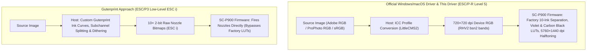

# Why `ESC/P-R` instead of Gutenprint (`escp2`)?

For many years, **[Gutenprint (`libgutenprint`)](https://gimp-print.sourceforge.io/)**
was the gold standard – and often the *only* way – to drive professional Epson
photo printers on Linux (such as the Stylus Photo R2880, R3000, SureColor
SC-P600, and **SC-P800**).

With the **SureColor SC-P900** (and SC-P700), Epson fundamentally changed the
printer's architecture. This page explains why driving the SC-P900 via
**`ESC/P-R Level 5`** (what this driver does) is the right choice for standard
photo and fine-art workflows, and what role a low-level Gutenprint (`ESC i`)
driver would play.

---

## 1. The Architectural Shift: SC-P800 vs. SC-P900

### Older Epson Pro printers (up to the SC-P800)
On earlier models, the printer hardware did not contain an internal RGB-to-ink
raster image processor (RIP) for high-resolution photo modes:
- The **Windows/macOS driver on the host PC** had to perform 8- or 9-channel ink
  separation (`C, LC, VM, VLM, Y, PK/MK, LK, LLK`), variable-sized droplet
  dithering (1.5 pl / 3 pl / 7 pl), and MicroWeave pass scheduling in software.
- The host then sent raw 2-bit-per-nozzle droplet bitmaps (`ESC i` raster bands)
  to the printer.
- Because Epson never released that proprietary host-side RIP for Linux,
  **Gutenprint had to re-implement the entire ink separation and halftoning
  engine on the host**.

### The SC-P900 / SC-P700 (`ESC/P-R Level 5`)
On the SC-P900 and SC-P700, Epson moved the entire 10-channel ink separation,
factory-calibrated look-up tables (LUTs), variable droplet dithering, and
MicroWeave pass scheduling **into the printer's own firmware/ASIC**:
- Even **Epson's official Windows and macOS drivers** no longer send raw nozzle
  droplet bitmaps (`ESC i`) during normal printing.
- Instead, the official driver transforms the image into the paper's ICC profile
  on the computer and sends **720 × 720 dpi 24-bit RGB bands** (`ESC d bsn2`
  compressed with `RHV2`, with `LUT = 4` / *No Color Adjustment*) to the
  printer, even when **"Max Quality (5760 × 1440 dpi)"** or **"Carbon Black"**
  is selected.
- The printer firmware then expands those 720 dpi RGB pixels into 10-channel
  (`PK, MK, LK, LLK, C, LC, VM, VLM, Y, Violet`) droplet patterns at up to
  5760 × 1440 dpi using Epson's factory-calibrated tables.

---

## 2. Why `ESC/P-R` is better for Photo & Fine-Art Printing

Because `rastertop900escpr` feeds the exact same `ESC/P-R Level 5` pipeline as
Epson's Windows and macOS drivers, you get two decisive advantages that a
Gutenprint `ESC i` driver cannot provide out of the box:

### 1. 100% Compatibility with Official Epson & Paper-Maker ICC Profiles (`.emx`)
Every ICC profile published for the SC-P900 — both **Epson's 16 official media
profiles** and third-party profiles from **Hahnemühle, Canson, Photolux,
Ilford, Moab, and Felix Schoeller** — was measured and profiled on top of
**Epson's firmware `ESC/P-R` ink separation (`LUT = 4`)**.
- With **this driver**, all official Epson and third-party `.icc` / `.emx`
  profiles work **1:1 as intended**, producing prints that are visually
  indistinguishable from Windows/macOS (verified in daylight side-by-side tests).
- With **Gutenprint (`ESC i`)**, Epson's firmware LUTs are bypassed and replaced
  by Gutenprint's own ink splitting and halftoning curves. Consequently,
  **standard Epson and paper-manufacturer ICC profiles do not match a Gutenprint
  driver**; every paper would have to be re-linearized and re-profiled from
  scratch using a spectrophotometer.

### 2. Native Support for Carbon Black, Black Enhance Overcoat & NVRAM Slots
- **Carbon Black (`5760 × 1440 dpi`)** and **Black Enhance Overcoat** are complex
  multi-pass firmware modes on the SC-P900 that boost $D_{\max}$ and gloss
  uniformity on photo and baryta papers. In `ESC/P-R` mode, the firmware executes
  these modes natively when requested via `ESC q setq` / `ESC q seti`.
- Likewise, the printer's **30 custom media NVRAM slots (`ESC q setl`)** store
  mechanical and feed parameters managed via `.emx` files (`ep-media-installer`).

---

## 3. When would a Gutenprint (`ESC i`) driver still be useful?

Bypassing the printer's internal RIP via `ESC i` (the Gutenprint approach) is
only advantageous in specialized scenarios where you **explicitly want to
override Epson's firmware ink rules**:

| Use case | Best choice | Why |
|---|---|---|
| **Color & B&W Fine-Art photography** with Epson, Hahnemühle, Canson, Photolux papers | **This driver (`ESC/P-R`)** | Uses Epson's factory 10-channel linearization and works with all official & vendor `.icc`/`.emx` profiles |
| **Soft-proofing workflows** (`LumaPrint`, darktable, GIMP) | **This driver (`ESC/P-R`)** | Soft-proof on screen matches the print without custom spectrophotometer profiling |
| **Screen-printing film positives / UV contact negatives** (Platinum/Palladium, Cyanotype) | **Gutenprint (`ESC i`)** | Requires firing specific UV-blocking channels (`PK + MK + Y + V`) simultaneously or exceeding normal ink limits |
| **Custom third-party inksets / Piezography** | **Gutenprint (`ESC i`)** | Requires direct per-nozzle channel control when non-Epson inks are loaded into the cartridges |
| **Pure-carbon B&W research** (forcing 0.0% color ink with custom `LLK/LK/MK` crossover curves) | **Gutenprint (`ESC i`)** | Allows manual control over subchannel transitions if Epson's `AdvancedBW` mode is not desired |

In short: for **photographic and fine-art printing with original UltraChrome
PRO10 inks**, the SC-P900's built-in RIP driven via `ESC/P-R Level 5` already
delivers the exact reference quality of the official Windows/macOS driver.
