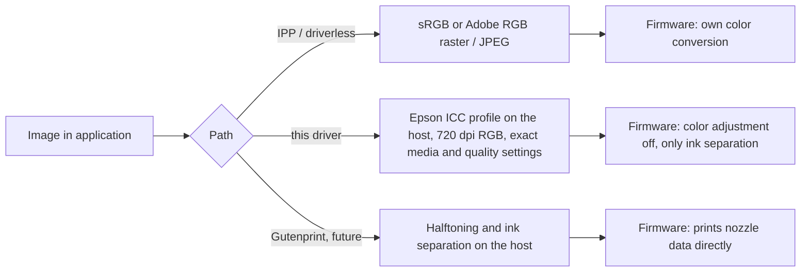

# Why not just use IPP / driverless printing?

Modern Linux distributions can print to the SC-P900 without any driver
("driverless", IPP Everywhere / AirPrint). For documents that is perfectly
fine. For photographic work there is a visible – if small – difference. This
page explains where it comes from.

## Three ways to drive the SC-P900 from Linux

In **all three** cases the computer sends something to the printer that the
firmware still has to turn into ink droplets – with the first two paths the
firmware also decides how RGB is split into the ten inks and three droplet
sizes. The difference is **who does the color management** and **how precisely
the printer is configured**.

## A common misconception

> "The Windows driver is a RIP; the printer firmware only has simple color
> handling, so IPP can never match it."

This is not what we found. The official Windows/macOS driver sends
**720 × 720 dpi 24-bit RGB** (Epson ESC/P-R) to the SC-P900 – even at the
"5760 dpi" setting. Ink separation and halftoning happen in the printer firmware
for the official driver too. What the official driver adds is:

1. **Color management on the host** with the Epson ICC profile made for the
   selected paper, and the printer's own color adjustment switched off.
2. **Exact printer setup**: the firmware media ID, the quality level allowed for
   that paper, Black Enhance Overcoat, Carbon Black mode.

This driver does exactly the same, which is why its prints are
indistinguishable from the Windows driver (see below).

## What the SC-P900 offers over IPP

Queried from the printer with `ipptool` (firmware as of October 2026):

| | IPP / driverless | this driver / Epson driver |
|---|---|---|
| Media types | 16, including Epson-specific ones (`com.epson-luster`, `com.epson-fine-art`, `com.epson-velvet-fine-art`, canvas, washi, baryta, …) | 18 |
| Paper sources | `auto`, `rear`, `tray-1` … `tray-3` | rear, front feeds, disc tray, roll |
| Quality | `draft`, `normal`, `high` | per paper, up to Max and Carbon Black |
| Raster resolution | PWG raster **360 dpi only**; Apple URF 360–720 dpi; JPEG | 720 dpi |
| Color input | sRGB or Adobe RGB, converted by the firmware | per-paper Epson ICC profile on the host, printer color adjustment off |
| Your own ICC profiles (e.g. from a paper manufacturer) | not possible – the firmware conversion is always applied | yes: convert with your profile in the application and print with `EpsonColorMode=NoColorAdjustment` |
| Black Enhance Overcoat / Carbon Black | not selectable | yes |

So media selection over IPP is better than one might expect. The real
limitations are **color management** and the **raster resolution**.

## Side-by-side test

The same image (PDI test image, 148.7 × 218.7 mm on A4, Epson Photo Paper
Glossy, rear feeder, quality "High") was printed three ways:

| Comparison | Result |
|---|---|
| Windows driver (Epson Print Layout, Epson ICC, relative colorimetric + BPC) vs. **this driver** | **No visible difference**, also in daylight |
| **IPP / driverless** (`PhotographicGlossy`, quality High) vs. the other two | Small difference, hard to spot for most people: gray ramp neutral but slightly lighter (gamma); colors slightly lighter and less saturated, dark skin tones look a little grayish; shadow detail equal; resolution difference just visible |

> [!NOTE]
> The IPP print was made from an sRGB version of the image (as most
> applications send sRGB), while the other two used the embedded Adobe RGB
> profile. Part of the lower saturation may therefore come from the smaller sRGB
> gamut rather than from the firmware conversion. IPP also offers an Adobe RGB
> mode, which has not been tested yet.

## When IPP is enough – and when it is not

| Use case | Recommendation |
|---|---|
| Documents, plain paper, quick prints | IPP / driverless |
| Photos where "very good" is enough | IPP works, differences are small |
| Exhibition prints, matching a soft-proof, third-party papers with their own ICC profiles, Carbon Black / Overcoat | this driver |
| Full control over ink separation and halftoning, own calibration | Gutenprint (work in progress) |

See also [resolution.md](resolution.md) for why 720 dpi RGB is enough even
though the printer advertises 5760 × 1440 dpi.
